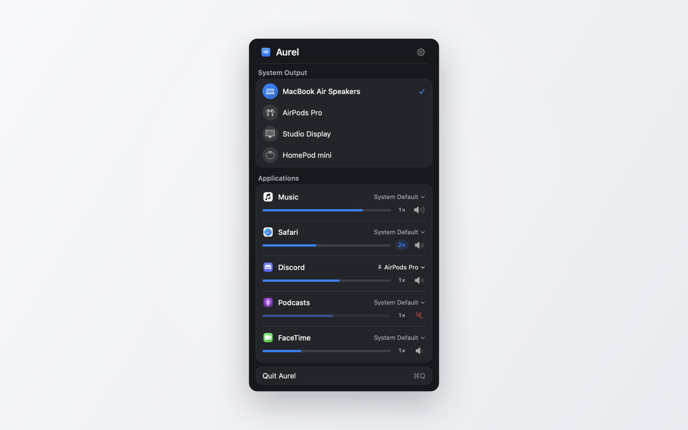
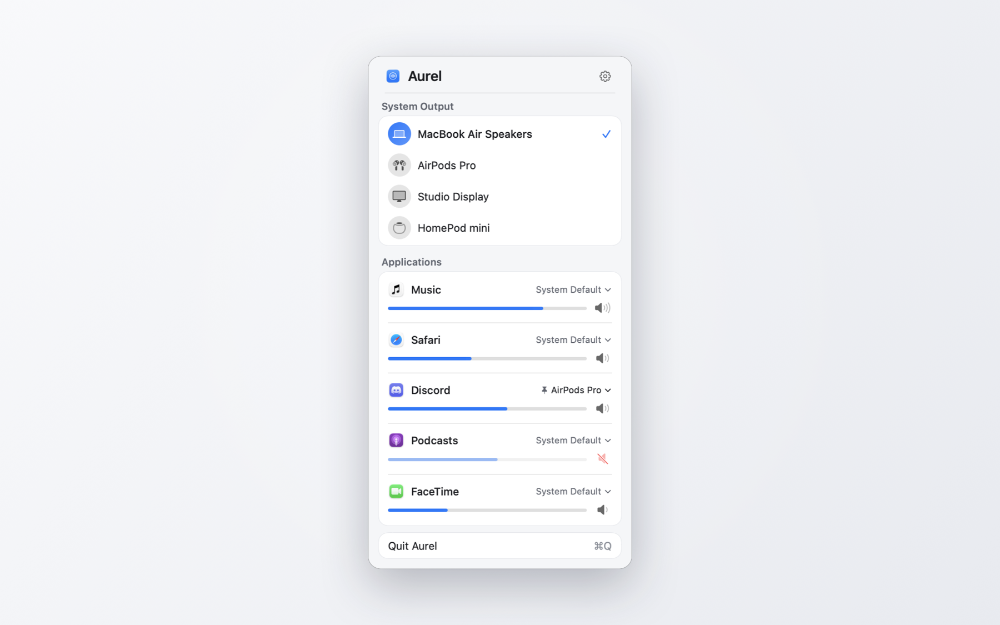

<p align="center">
  
</p>

<h1 align="center">Aurel</h1>

<p align="center">
  <strong>Every app, its own volume.</strong><br>
  A quiet, native mixer for your Mac — right in the menu bar.
</p>

<p align="center">
  
  
  
</p>

<p align="center">
  <picture>
    <source media="(prefers-color-scheme: light)" srcset="assets/screenshots/popup-light.png">
    
  </picture>
</p>

Music up, notifications down, the video call exactly where you want it. Aurel gives each app its own volume, mute and output — without extra drivers, accounts or clutter.

## Features

- **Per-app volume** — a full-width slider for every app that's playing sound. The level is remembered the next time the app plays.
- **Per-app mute** — silence one app with a single click and leave the rest alone.
- **System output in one place** — switch between speakers, headphones and displays from the same panel.
- **Per-app output** — keep music on your speakers and send a call to your headphones. Apps follow the system output by default; a small pin marks any app you route on purpose.
- **Pinned and hidden apps** — keep favourite apps in the list even when they're quiet, or hide the ones you never want to touch.
- **Keyboard friendly** — move with ↑ ↓, adjust with ← →, press M to mute, or type a number to set a level.
- **Feels built in** — native controls, Liquid Glass on macOS 26, and full support for light and dark appearance.

## Screenshots

<table>
  <tr>
    <td align="center" width="50%">
      <br>
      <sub><b>Dark</b></sub>
    </td>
    <td align="center" width="50%">
      <br>
      <sub><b>Light</b></sub>
    </td>
  </tr>
</table>

<!--
  More screenshots: capture the panel or window (⌘⇧4, Space, click), then run
  swift scripts/readme-screenshot.swift capture.png assets/screenshots/<name>.png <left> <top> <right> <bottom>
  and add a row above (e.g. output-menu.png, settings.png).
-->

## Private by design

All audio is processed locally on your Mac. Aurel doesn't record, save or upload any sound, has no account and collects no analytics. It uses the macOS audio capture APIs — no kernel extensions or virtual audio drivers to install.

## Requirements

- macOS 15.4 or later
- A Mac with Apple Silicon
- Permission for **System Audio Recording** (asked on first launch). Accessibility is optional and only used for the volume keys.

## Install

1. Download **Aurel.dmg** from the [latest release](../../releases/latest).
2. Open the disk image and drag **Aurel** to **Applications**.
3. Open Aurel. Because this early build isn't notarized by Apple yet, macOS blocks it the first time:
   - open **System Settings › Privacy & Security**, scroll down and click **Open Anyway** next to Aurel, then confirm.
   - or, in Terminal: `xattr -dr com.apple.quarantine /Applications/Aurel.app`
4. Follow the short welcome and allow **System Audio Recording** when macOS asks.

Aurel lives in the menu bar — look for the sound-wave icon.

## Tips

- **Calls sound quiet in other apps?** During a call, macOS lowers the volume of every other app on the active output. This is system behaviour and happens with or without Aurel. For the best call quality, hide your calling app in Aurel (right-click › Hide).
- **Switching outputs often?** Leave apps on **System Default** so they follow the output you pick. Use a fixed output only when you really want an app on a specific device.
- **Don't run Aurel alongside another per-app volume tool** — both would try to manage the same audio.

## Building from source

Requires Xcode 26 or later.

```bash
git clone https://github.com/Eduardo00873/Aurel.git
cd Aurel
xcodebuild -project FineTune.xcodeproj -scheme FineTune -configuration Debug build
```

The app is created as `Aurel.app` in Xcode's build folder. Release builds need to be signed with your own Apple Development or Developer ID certificate.

Run the tests:

```bash
xcodebuild test -project FineTune.xcodeproj -scheme FineTune -skip-testing:FineTuneUITests
```

## License

Aurel is free software, released under the [GNU General Public License v3.0](LICENSE). See [NOTICE](NOTICE.md) for credits.

<p align="center"><sub>© 2026 Eduardo Carvalho</sub></p>
